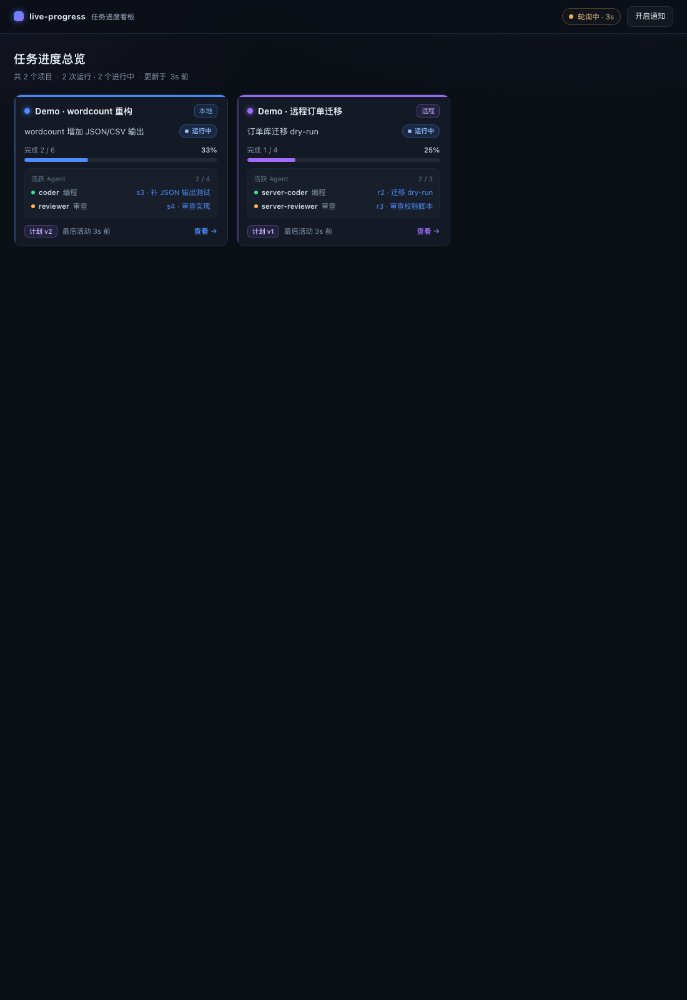
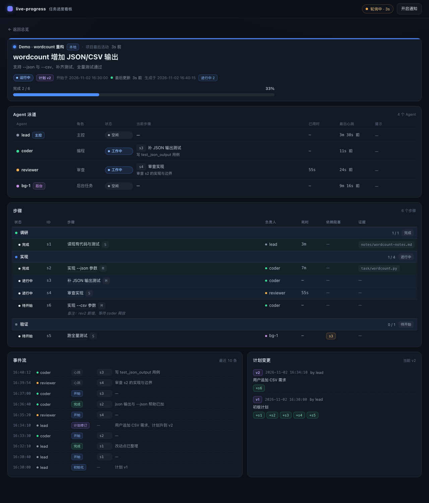

# live-progress

给 DSH 多 agent 任务用的实时进度看板。**文件是唯一事实源**：主 agent 维护带版本号的计划，
每个 agent 往自己的事件文件追加事实；一个本地 hub 把它们渲染成实时网页（泳道 + 步骤表），
并支持远程任务推送到本地、桌面通知、多项目总览。

- 页面不会被"后台静默等待"卡住：耗时每秒本地计时，最后事件时间实时显示。
- 并行多个 agent：泳道一人一行，谁在干什么、卡在哪一步一目了然。
- 支持远程执行：服务器把事件推到本地 hub，或通过 SSH 隧道直接看。
- 纯标准库：Python 3.9+，无第三方依赖。

## 预览




> 截图为示例数据；实际页面由本地 hub 实时渲染（泳道每秒计时，事件即时推送）。

## 快速开始

```bash
# 1) 起一个看板 hub（本地）
python3 skill/scripts/board.py serve --port 8770

# 2) 跑内置演示：两个项目、并行 agent、后台任务、计划变更、远程推送
python3 demo/run_demo.py --open
```

浏览器打开 <http://127.0.0.1:8770/>，总览页会同时出现
「Demo · wordcount 重构」（本地）和「Demo · 远程订单迁移」（ingest 推送）。

## 目录

```
live-progress/
├── skill/
│   ├── SKILL.md                  # agent 协议（启动/执行/收尾/远程）
│   ├── scripts/board.py          # CLI + hub + SSE + ingest + 通知
│   └── templates/board.html      # 单文件看板页面
├── demo/
│   ├── run_demo.py               # 两项目演示（本地并行 + 远程推送）
│   └── demo_a/task/              # 被操作的示例小项目
├── tests/test_board.py           # 标准库 unittest
└── docs/{contract.md,state.sample.json}
```

## 安装为 DSH skill

任选其一，DSH 会自动发现并热加载：

```bash
# 项目级（只对当前项目生效）
mkdir -p .dsh/skills && ln -s ../../live-progress/skill .dsh/skills/live-progress
# 或用户级（所有项目生效）
ln -s "$PWD/live-progress/skill" ~/.dsh/skills/live-progress
```

之后在会话里让 agent「加载 live-progress skill」即可；SKILL.md 里包含完整命令与协议。

## 数据与命令

- 运行数据：`<project>/.dsh/progress/runs/<runId>/`（`plan.json`、`events/`、`state.json`、`BOARD.md`）
- hub 注册表：`~/.dsh/progress/projects.json`；远程镜像：`~/.dsh/progress/inbox/`
- 沙箱只允许工作区写入时，hub 自动回退到 `<cwd>/.dsh/progress/hub`。

常用：

```bash
B="python3 skill/scripts/board.py"
$B init --project-id demo --name 示例 --plan-file plan.json
$B start s1 --agent lead && $B done s1 --agent lead --evidence out.log --start s2
$B exec s2 --agent coder --heartbeat 30 --timeout 1800 -- pytest -q   # 长命令自动记账
$B status [--json] [--all]
$B revise --plan-file plan.v2.json --reason "需求变更"
$B close --by lead
$B serve --port 8770 [--open]
$B project add --id shop-api --kind ingest      # 远程推送项目，打印 token
$B push --to http://127.0.0.1:8770 --project-id shop-api
```

三层协议：Lead 流程在 `SKILL.md`，子 agent/程序的记账协议在 `references/record.md`，
`board.py exec` 让长命令和后台 job 自己写 start/心跳/终态，不依赖 agent 记得轮询。

## 远程与安全

- 默认只监听 `127.0.0.1`；非回环需 `--allow-remote`。
- 远程推送走 `POST /api/ingest`（也支持 GET `?payload=`），token 校验、事件 `uuid` 幂等。
- 更稳妥的方式：服务器只绑回环，本地 `ssh -L 8770:127.0.0.1:8770 server` 后浏览本地端口。
- 接口契约见 [docs/contract.md](docs/contract.md)。

## 通知

默认只对「运行完成 / 步骤失败 / 步骤阻塞 / 计划升版 / agent 停滞」弹通知；
步骤开始不通知。页面打开时用浏览器 Notification，页面关闭时由 hub 调用系统通知。
页面每 10 秒上报一次 presence，避免重复弹窗。

## 测试

```bash
python3 -m unittest discover -s tests -v
```

## 设计取舍

- 为什么不是"服务当总线"：服务随时可挂、可换、可重启；文件永远可审计、可回放。
- 为什么事件按 agent 分文件：多 agent 并行追加零锁冲突；快照由渲染端合并。
- 为什么计划要和事件分开：改范围是 Lead 的决策，执行事实是各 agent 的产出，混在一起就无法审计。
- 为什么页面轮询/SSE 读快照：模型不需要为"刷新"消耗 token，用户看到的始终是最新事实。
